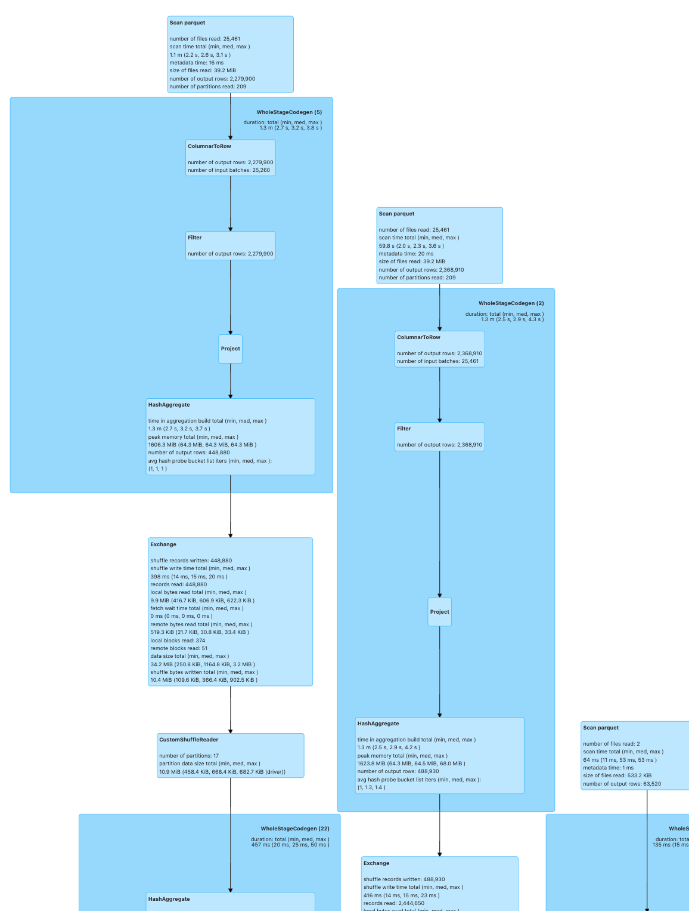
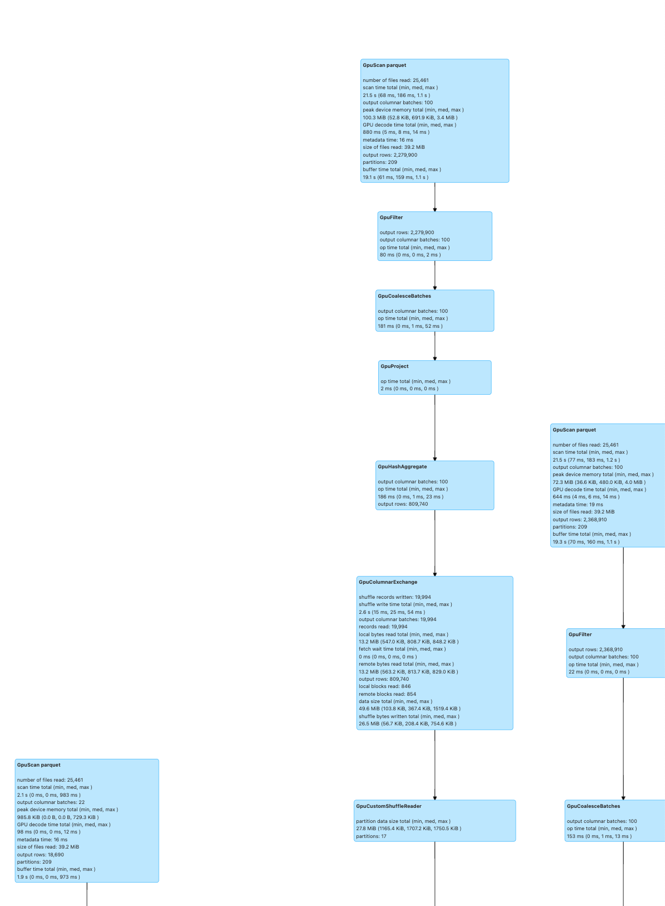
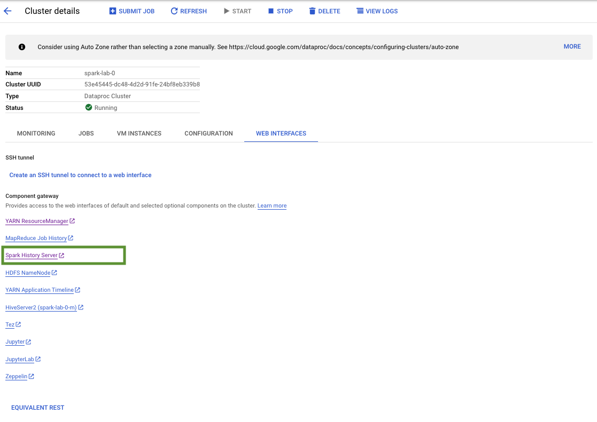
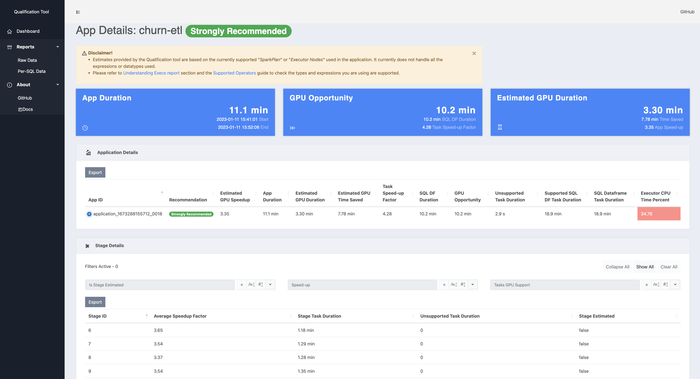

<!--
 Copyright NVIDIA Corporation.
 
 Licensed under the Apache License, Version 2.0 (the "License");
 you may not use this file except in compliance with the License.
 You may obtain a copy of the License at

     http://www.apache.org/licenses/LICENSE-2.0

 Unless required by applicable law or agreed to in writing, software
 distributed under the License is distributed on an "AS IS" BASIS,
 WITHOUT WARRANTIES OR CONDITIONS OF ANY KIND, either express or implied.
 See the License for the specific language governing permissions and
 limitations under the License.
-->

# Spark RAPIDS Dataproc Lab

## Overview

This lab demonstrates GPU acceleration for Apache Spark using RAPIDS on Google Cloud Dataproc. It compares CPU vs GPU performance on a customer churn ETL workload.

This demo is derived from [data-science-blueprints](https://github.com/NVIDIA/data-science-blueprints) repository and it demonstrates a realistic ETL workflow based on synthetic normalized data. 

## Cluster Creation

### Prerequisites

Set environment variables:

```bash
export CLUSTER_NAME=spark-lab
export GCS_BUCKET=<your-gcs-bucket-name>
export REGION=us-central1
export ZONE=us-central1-b
export NUM_GPUS=1
export NUM_WORKERS=2
export PROJECT_ID=$(gcloud config get-value project)
```

```bash
# Networking: this lab assumes the default VPC/subnet unless you override these.
export NETWORK=default
export SUBNET=default
```

**Network Requirements:**

1. **Route Requirements**: The VPC network must have a default route (0.0.0.0/0) to the internet gateway. This exists by default in the `default` VPC network. For custom VPC networks, ensure the default route exists.

2. **Ingress firewall rule** (required for VM-to-VM communication):

```bash
SUBNET_RANGE=$(gcloud compute networks subnets describe "$SUBNET" \
  --network "$NETWORK" \
  --region "$REGION" \
  --format="value(ipCidrRange)")
if ! gcloud compute firewall-rules describe allow-dataproc-internal >/dev/null 2>&1; then
  gcloud compute firewall-rules create allow-dataproc-internal \
    --network="$NETWORK" \
    --direction=INGRESS \
    --allow=tcp:0-65535,udp:0-65535,icmp \
    --source-ranges="$SUBNET_RANGE" \
    --priority=1000 \
    --description="Allow Dataproc internal traffic within subnet '$SUBNET' ($SUBNET_RANGE) in VPC '$NETWORK' (applies to all VMs)"
else
  echo "Firewall rule 'allow-dataproc-internal' already exists"
fi
```

**Note:** The rule applies to all VMs in the subnet (no target tags) to ensure connectivity even if network tags aren't assigned during cluster creation.

3. **Egress firewall rule** (only needed if you have egress deny rules):

```bash
if ! gcloud compute firewall-rules describe allow-dataproc-egress >/dev/null 2>&1; then
  gcloud compute firewall-rules create allow-dataproc-egress \
    --network="$NETWORK" \
    --direction=EGRESS \
    --allow=tcp:0-65535,udp:0-65535,icmp \
    --destination-ranges=0.0.0.0/0 \
    --priority=1000 \
    --description="Allow Dataproc egress traffic from VPC '$NETWORK' (applies to all VMs)"
else
  echo "Firewall rule 'allow-dataproc-egress' already exists"
fi
```

**External access** (choose one):

```bash
# Option 1: Public IPs
# Add --no-internal-ip-only to cluster create command
```

```bash
# Option 2: Cloud NAT (for internal-IP-only clusters)
gcloud compute routers create default-cr --network="$NETWORK" --region $REGION 2>/dev/null || echo "Router exists"
gcloud compute routers nats create default-nat --router=default-cr --router-region $REGION --nat-all-subnet-ip-ranges --auto-allocate-nat-external-ips 2>/dev/null || echo "NAT exists"
```

Note: for more information about Dataproc networking requirements please refer to the [documentation](https://docs.cloud.google.com/dataproc/docs/concepts/configuring-clusters/network)

Create the GPU module signing secrets and grant access (required for signed NVIDIA kernel modules):

```bash
gcloud secrets create dataproc-gpu-signing-private --replication-policy=automatic
gcloud secrets create dataproc-gpu-signing-public --replication-policy=automatic
gcloud secrets versions add dataproc-gpu-signing-private --data-file=/path/to/private.key
gcloud secrets versions add dataproc-gpu-signing-public --data-file=/path/to/public.pem

PROJECT_NUMBER=$(gcloud projects describe "$PROJECT_ID" --format="value(projectNumber)")
SA="${PROJECT_NUMBER}-compute@developer.gserviceaccount.com"
gcloud secrets add-iam-policy-binding dataproc-gpu-signing-private --member="serviceAccount:$SA" --role="roles/secretmanager.secretAccessor"
gcloud secrets add-iam-policy-binding dataproc-gpu-signing-public --member="serviceAccount:$SA" --role="roles/secretmanager.secretAccessor"
```

Note: `public.pem` should be an X.509 certificate (not an OpenSSH public key). You can generate it from your private key:

```bash
openssl req -new -x509 -key /path/to/private.key -out /path/to/public.pem -days 3650
```

Create the Dataproc cluster:

```bash
gcloud dataproc clusters create $CLUSTER_NAME  \
    --region $REGION \
    --zone $ZONE \
    --image-version=2.1-ubuntu20 \
    --master-machine-type n1-standard-4 \
    --master-boot-disk-size 200 \
    --num-workers $NUM_WORKERS \
    --worker-accelerator type=nvidia-tesla-t4,count=$NUM_GPUS \
    --worker-machine-type n1-standard-8 \
    --num-worker-local-ssds 1 \
    --initialization-actions=gs://goog-dataproc-initialization-actions-${REGION}/spark-rapids/spark-rapids.sh \
    --initialization-action-timeout=60m \
    --optional-components=JUPYTER,ZEPPELIN \
    --metadata=rapids-runtime=SPARK,private_secret_name=dataproc-gpu-signing-private,public_secret_name=dataproc-gpu-signing-public,secret_version=latest,secret_project=$PROJECT_ID \
    --scopes=https://www.googleapis.com/auth/cloud-platform \
    --bucket $GCS_BUCKET \
    --subnet=default \
    --enable-component-gateway \
    --no-shielded-secure-boot
```

Important considerations:

- Secret payloads must be valid (private key PEM, public X.509 cert in `public.pem`).
- `secret_version=latest` (or a specific version) is required; otherwise secret access fails.
- VM OAuth scopes must include Secret Manager access (`--scopes=https://www.googleapis.com/auth/cloud-platform`).
- Ensure worker nodes have outbound internet access for driver downloads (public IPs or Cloud NAT).

Copy dataset to GCS bucket:

```bash
gcloud storage cp spark-rapids-churn/01-datasets/WA_Fn-UseC_-Telco-Customer-Churn-.csv gs://$GCS_BUCKET/
```

Copy scripts to master node:

```bash
gcloud compute scp --recurse spark-rapids-churn/00-scripts-and-config/dataproc-churn/* ${CLUSTER_NAME}-m:~/ --zone=${ZONE} --tunnel-through-iap
```

SSH into master node:

```bash
gcloud compute ssh ${CLUSTER_NAME}-m --zone=${ZONE} --tunnel-through-iap
```

On the master node, create zip archive:

```bash
zip archive.zip -r churn generate.py
```

Update `gen.env.sh`:
- Set `INPUT_FILE` to `gs://$GCS_BUCKET/WA_Fn-UseC_-Telco-Customer-Churn-.csv`
```bash
sed -i.bak "s|^INPUT_FILE=.*|INPUT_FILE=\"gs://$GCS_BUCKET/WA_Fn-UseC_-Telco-Customer-Churn-.csv\"|" gen.env.sh
```
- Configure resources for your cluster (2 n1-standard-8 workers)

Generate dataset:

```bash
./generate.sh
```

## CPU Job

Update `cpu.env.sh`:
- Set `INPUT_PREFIX` to `hdfs:///data/10scale/`
```bash
sed -i.bak "s|^INPUT_PREFIX=.*|INPUT_PREFIX=\"hdfs:///data/10scale/\"|" cpu.env.sh
```
- Configure resources for your cluster

Run CPU ETL job:

```bash
./cpu_etl.sh
```

Example CPU SQL plan (verifies the job is running on CPU):



Download event logs from Spark History Server UI for qualification analysis.

## GPU Job

Update `gpu.env.sh`:
- Set `INPUT_PREFIX` to `hdfs:///data/10scale/`
```bash
sed -i.bak "s|^INPUT_PREFIX=.*|INPUT_PREFIX=\"hdfs:///data/10scale/\"|" gpu.env.sh
```
- Configure resources for your cluster (2 GPUs)

Run GPU ETL job:

```bash
./gpu_etl.sh
```

Example GPU SQL plan (verifies RAPIDS GPU operators are being used):



## Rapids Qualification Tool (run locally)

Install prerequisites:

```bash
python3.12 -m venv .venv
source .venv/bin/activate
pip install spark-rapids-user-tools
brew install libomp openjdk@11
export JAVA_HOME=$(brew --prefix openjdk@11)/libexec/openjdk.jdk/Contents/Home
```

Download event logs from Spark History Server:

1. In the Dataproc console, open your cluster.
2. Click **Web Interfaces** → **Spark History Server**.
3. Find the **churn-etl** CPU run (`application_..._0003`) and click it.
4. Use the **Download event logs** button to save the ZIP locally (e.g., `~/Downloads/eventlogs/`).

Example Spark History Server location in Dataproc:



Extract event logs:

```bash
mkdir -p ./eventlogs
unzip ~/Downloads/eventlogs/eventLogs-application_*.zip -d ./eventlogs/
```

Run qualification tool:

```bash
spark_rapids qualification \
  --platform dataproc \
  --eventlogs file://$(pwd)/eventlogs/ \
  --output_folder ./qualification_output
```

View results in `qualification_output/qual_*/qualification_summary.csv`.

Example qualification tool output:



## Conclusion

Compare CPU vs GPU execution times. The qualification tool provides estimated GPU speedup predictions based on event log analysis.